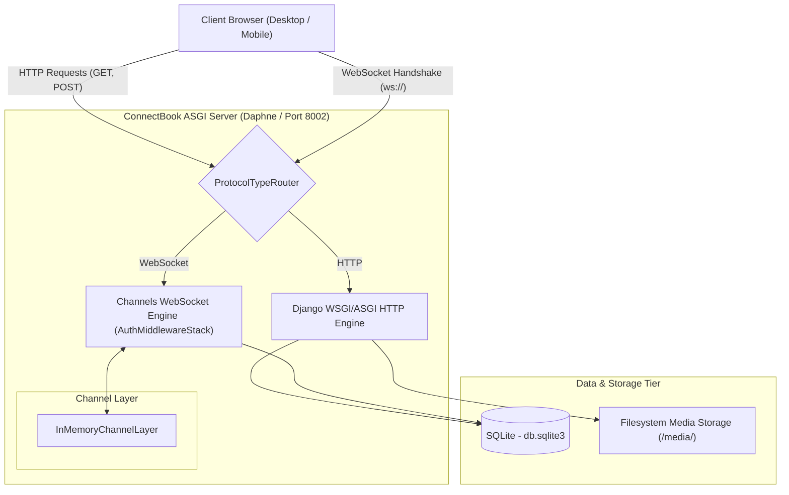

# CONNECTBOOK – SYSTEM ARCHITECTURE

## 1. Architectural Model
ConnectBook is structured around an **Asynchronous Hybrid Architecture** leveraging the Django MTV (Model-Template-View) design pattern alongside an ASGI event-loop powered by **Daphne** and **Django Channels**.

## 2. Key Components

### A. Daphne ASGI Server
Daphne processes all inbound HTTP and WebSocket connections on port `8002`. This allows real-time chat messages and live notification broadcasts to stream simultaneously without dedicated external services like Redis.

### B. In-Memory Channel Layer
During development and single-instance deployments, the `InMemoryChannelLayer` enables fast, zero-dependency inter-process group communication (`chat_<id>` and `notify_<id>`).

### C. Fallback Architecture
For high resilience, every WebSocket module (Messenger, notifications, reactions) contains a graceful client-side HTTP polling fallback. If a client connection blocks WebSockets, standard Fetch API requests seamlessly take over.

### D. File Storage Strategy
Files uploaded by users (avatars, cover photos, post images, video clips) are written directly to local media directories (`media/`) and served with validated content types and paths, preventing binary bloat in SQLite.
