# CONNECTBOOK – ENTITY RELATIONSHIP (ER) DIAGRAM

```mermaid
erDiagram
    CUSTOMUSER ||--|| USERPROFILE : has
    CUSTOMUSER ||--|| USERPREFERENCE : configures
    CUSTOMUSER ||--|| USERPRIVACYSETTING : configures
    CUSTOMUSER ||--o{ FOLLOW : follows
    CUSTOMUSER ||--o{ USERSESSIONRECORD : active_session
    CUSTOMUSER ||--o{ DATAEXPORTREQUEST : requests
    CUSTOMUSER ||--o{ ACCOUNTDELETIONREQUEST : submits
    CUSTOMUSER ||--o{ POST : authors
    CUSTOMUSER ||--o{ REACTION : creates
    CUSTOMUSER ||--o{ COMMENT : writes
    CUSTOMUSER ||--o{ STORY : publishes
    CUSTOMUSER ||--o{ FRIENDSHIP : participates
    CUSTOMUSER ||--o{ FRIENDREQUEST : sends_or_receives
    CUSTOMUSER ||--o{ NOTIFICATION : receives
    CUSTOMUSER ||--o{ GROUPMEMBERSHIP : joins
    CUSTOMUSER ||--o{ PAGE : owns
    CUSTOMUSER ||--o{ PAGEFOLLOW : follows
    CUSTOMUSER ||--o{ EVENT : organizes
    CUSTOMUSER ||--o{ EVENTRSVP : rsvps
    CUSTOMUSER ||--o{ MARKETPLACELISTING : sells
    CUSTOMUSER ||--o{ LIVESTREAM : broadcasts
    CUSTOMUSER ||--o{ CONVERSATIONPARTICIPANT : engages
    CUSTOMUSER ||--o{ MESSAGE : sends

    POST ||--o{ POSTMEDIA : contains
    POST ||--o{ REACTION : receives
    POST ||--o{ COMMENT : receives
    POST ||--o{ SAVEDPOST : bookmarked_in
    POST }o--o| GROUP : posted_in
    POST }o--o| PAGE : posted_in
    POST }o--o| POST : shares

    COMMENT ||--o{ COMMENT : replies_to
    COMMENT ||--o{ COMMENTREACTION : receives

    STORY ||--o{ STORYVIEW : tracked_by

    GROUP ||--o{ GROUPMEMBERSHIP : has
    GROUP ||--o{ GROUPJOINREQUEST : receives
    GROUP ||--o{ POST : hosts

    PAGE ||--o{ PAGEFOLLOW : has
    PAGE ||--o{ POST : hosts

    EVENT ||--o{ EVENTRSVP : receives

    CONVERSATION ||--o{ CONVERSATIONPARTICIPANT : includes
    CONVERSATION ||--o{ MESSAGE : contains
```

### Relationship Highlights:
- **1-to-1:** `CustomUser` <-> `UserProfile` & `UserPreference`
- **1-to-Many:** `Post` <-> `PostMedia`, `Post` <-> `Comment`, `Conversation` <-> `Message`
- **Self-Referential:** `Comment` <-> `Comment` (for nested replies) and `Post` <-> `Post` (for shares)
- **Many-to-Many via Through Models:** Friendships, Group Memberships, and Conversation Participants.
